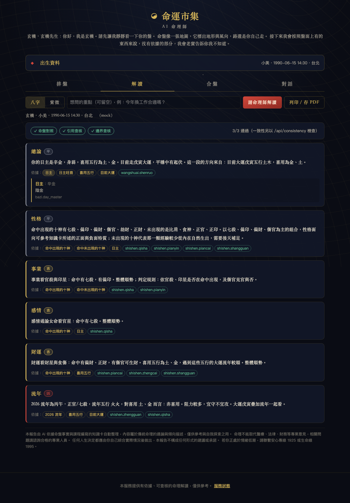
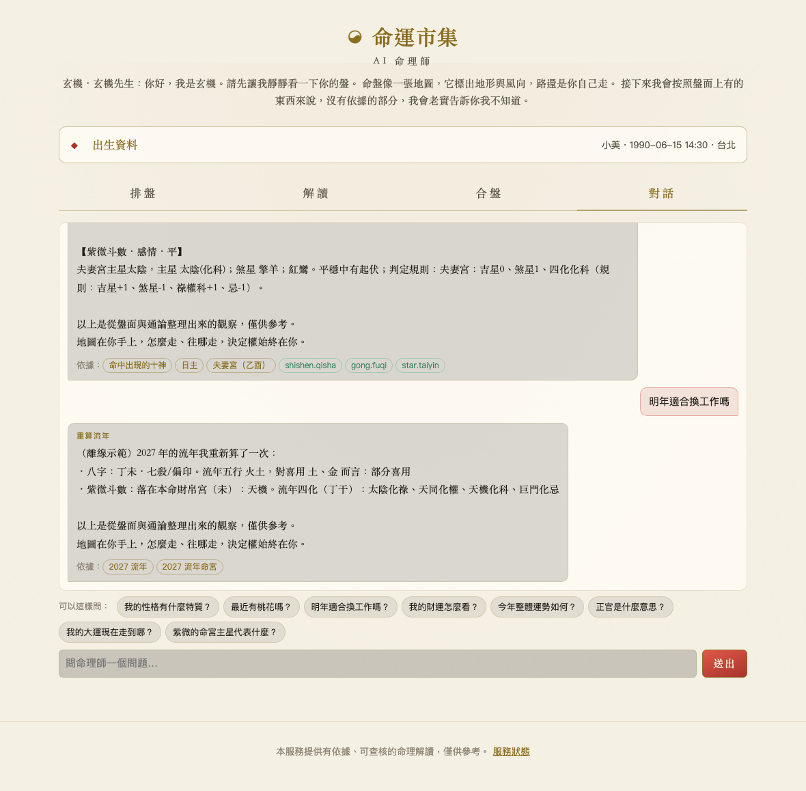

# 打造你的 AI 命理師 — 課程範例專案

輸入生辰，程式排出八字與紫微命盤；AI 寫出**每段都標明依據**的解讀；程式再把解讀**逐句查核**；還能做雙人合盤、多輪追問，放上網路給朋友用，也能接成 Telegram 機器人。

> 立場：不賣「準」，賣「查得到」。排盤交給程式、解讀交給 AI、你負責寫規格、做驗收。

這是線上課程「打造你的 AI 命理師」的範例專案，課程逐章帶你讀懂、改寫、部署它；沒上課也能直接跑起來用。

## 長什麼樣

| 八字四柱（十神、藏干、旺衰 v2、大運、流年、黃曆） | 紫微十二宮（四化、廟旺、十二長生、大限→流年） |
|---|---|
|  |  |

| 六段解讀，每段附依據與查核結果 | 雙人合盤，每一項都能追回盤上哪一格 |
|---|---|
|  |  |

| 對話：查卡、重算流年、越界婉拒 | 缺時辰：十二時辰候選，不硬猜 |
|---|---|
|  |  |

八字「詳細盤面」（農曆、節氣、起運交運、胎元命宮、納音、空亡、十二長生、神煞、刑沖合會、大運×流年、流月、稱骨）：[docs/img/bazi-detail.png](docs/img/bazi-detail.png)。同盤問三次的一致性表：[docs/img/consistency.png](docs/img/consistency.png)。流派面板與「派」角標（手錶時間派下晚子時不換日）：[docs/img/school.png](docs/img/school.png)。自帶金鑰選模型：[docs/img/byok.png](docs/img/byok.png)。一頁式報告（列印成 PDF）：[docs/img/report.png](docs/img/report.png)。今日用量與各模型成本：[docs/img/usage.png](docs/img/usage.png)。手機淺色模式：[docs/img/mobile-light.png](docs/img/mobile-light.png)。以上皆為離線模式（`LLM_BACKEND=mock`）的真實畫面。

## 三分鐘跑起來（第 3 章）

```bash
git clone https://github.com/ChiShengChen/bazaar-of-fates-course-code.git
cd bazaar-of-fates-course-code
python -m venv .venv && source .venv/bin/activate      # Windows: .venv\Scripts\activate
pip install -e ".[dev,llm]"
cp .env.example .env                                     # 先不用填金鑰
python -m fortune                                        # → http://localhost:8000
```

Python 用 3.11 到 3.14。最新的 3.15（2026-10-09 發布）先不要：算節氣的 `ephem` 還沒有 3.15 的安裝檔，`pip install` 會要求 Microsoft C++ 編譯工具。Python、Git、VS Code、Claude Code 怎麼裝，課程 3-0 有從零開始的示範。

Windows（PowerShell）第一行要拆開打，並指定版本；第一次啟動被擋（「因為這個系統上已停用指令碼執行」）時先改執行原則：

```powershell
py -V:3.14 -m venv .venv
Set-ExecutionPolicy -Scope CurrentUser RemoteSigned     # 只要做一次，問你時打 Y
.venv\Scripts\activate
```

沒有 AI 金鑰也能跑：預設 `LLM_BACKEND=mock`（離線模式），排盤照樣準確，解讀由程式依同一套事實與知識卡組出來，查核流程全部能示範。

### 接上你手上有的 AI（任一家都行）

`.env` 填兩行就好：

| `LLM_BACKEND` | `LLM_API_KEY` 去哪拿 | 預設模型（`LLM_MODEL` 可改） |
|---|---|---|
| **`deepseek`（課程預設）** | platform.deepseek.com | `deepseek-flash`（V4.1 Flash）— 一份解讀不到 $0.01、查核通過率與 Opus 相同；為什麼選它與資料政策考量見 [docs/model-choice.md](docs/model-choice.md) |
| `anthropic` | console.anthropic.com | `claude-opus-5-5` |
| `openai` | platform.openai.com | `gpt-4o-mini` |
| `gemini` | aistudio.google.com | `gemini-2.5-flash` |
| `openai_compatible` | 不用（本機）或該服務的金鑰 | 自填，另設 `LLM_BASE_URL`（Ollama `http://localhost:11434/v1`） |

**使用者也可以自帶金鑰**：網頁「AI 設定」面板選供應商、填自己的金鑰、載入並選模型；金鑰只存在使用者瀏覽器，每次請求轉給該供應商，伺服器不保存，費用不算站台預算（第 8-2、9-1 章）。

解讀、串流、對話的 tool use（重算流年／查知識卡）四家都支援；Claude 走官方 SDK 並開 prompt cache，其餘走 OpenAI 相容端點。任何一家失敗都自動退回離線模式，不會讓網站掛掉。頁首會顯示實際服務的模型與版本（`/api/health` 的 `model_info`）。

其他設定：`SCHOOL`（流派：`default`／`clock-time`／`zhongqi-tianfu`，或自己寫一個 yaml）、`LLM_THINKING`（思考深度 default／off／low／high，思考型模型的推理 token 會算錢）、`PERSONA`（`master`＝玄機、`yuelao`＝專看感情的月老，換風格只改一個名字）。同一張盤比多個模型：`python -m fortune.tools.compare_models bazi 1990-06-15 14:30 女 --models deepseek-flash@default deepseek-flash@off`，結果見 [docs/validation-models.md](docs/validation-models.md)。

終端機也能用：

```bash
python -m fortune cast 1990-06-15 14:30 女            # 排盤
python -m fortune reading bazi 1990-06-15 14:30 女    # 六段解讀＋查核
python -m fortune name 陳美玲 1990-06-15 14:30 女      # 姓名學：筆畫、五格、三才、配八字喜用
python -m fortune.tools.chart_check                    # 標準命例逐格驗收（4-2）
python -m fortune.tools.reading_check --demo ziwei 1990-06-15 14:30 女   # 解讀查核（第 6 章）
python -m fortune.tools.consistency bazi 1990-06-15 14:30 女            # 同盤問三次（6-5）
pytest                                                 # 全部測試（tests/e2e 需 playwright、tests/test_oracles 需 oracles，沒裝會自動跳過）
pip install -e ".[oracles]" && python -m fortune.tools.oracle_check --n 200   # 用 lunar-python／x-iztro 互證本引擎（4-2 進階）
```

## 姓名學（熊崎式五格）

出生資料填「姓名」，排盤分頁多一個「姓名」：每個字的康熙筆畫、天人地外總五格、三才、81 數理，以及各格五行對八字喜用。解讀一樣六段、標依據、跑查核，第六段改成「八字配合」（姓名不隨年份變）。

- 筆畫查得到：康熙筆畫＝部首原形筆畫＋其餘筆畫（氵算水 4、艹算艸 6、左阝算阜 8），資料來自 Unicode 官方 Unihan（`python -m fortune.tools.build_strokes` 產生 [fortune/xingming/strokes.tsv](fortune/xingming/strokes.tsv)），每個字都標出部首與 Unihan 編號
- 流派開關：筆畫用康熙或現代、一～十照數值或字形、單姓單名加不加假數；81 數理的吉凶分類在 [fortune/xingming/engine.py](fortune/xingming/engine.py) 頂端，照自己的師承改
- 標準命例在 [tests/cases/standard_cases.yaml](tests/cases/standard_cases.yaml) 尾段，`chart_check` 一起驗；複姓自動辨識，冠夫姓在姓與名之間加空白（`陳林 美玲`）

## 這個專案怎麼對應課程

| 章 | 做什麼 | 在哪裡 |
|---|---|---|
| 3 | 規格書、金鑰、第一次跑起來 | [docs/templates/spec_template.md](docs/templates/spec_template.md)、[.env.example](.env.example) |
| 4 | 排盤引擎：精確節氣、真太陽時、晚子時、閏月、十神、時辰不明、合盤 | [fortune/calendar/](fortune/calendar/)、[fortune/bazi/](fortune/bazi/)、[fortune/ziwei/](fortune/ziwei/)、[fortune/chart.py](fortune/chart.py)、[tests/cases/standard_cases.yaml](tests/cases/standard_cases.yaml) |
| 5 | 知識卡、AI 只讀盤面事實、六段固定格式 | [fortune/knowledge/](fortune/knowledge/)、[fortune/reading/prompt.py](fortune/reading/prompt.py)、[fortune/reading/sections.py](fortune/reading/sections.py) |
| 6 | 每段標依據、盤面核對、引用核對、越界檢查、一致性、驗收清單 | [fortune/reading/checks.py](fortune/reading/checks.py)、[fortune/reading/consistency.py](fortune/reading/consistency.py)、[docs/templates/reading_review_checklist.md](docs/templates/reading_review_checklist.md) |
| 7 | 對話、人設與拒答、東方魔幻介面、合盤頁 | [fortune/chat/session.py](fortune/chat/session.py)、[persona/master.yaml](persona/master.yaml)、[web/](web/) |
| 8 | 部署、用量上限、緊急開關、個資、Telegram | [deploy/](deploy/)、[fortune/api/limits.py](fortune/api/limits.py)、[fortune/bot/telegram.py](fortune/bot/telegram.py)、[docs/templates/launch_checklist.md](docs/templates/launch_checklist.md) |
| 9 | 成本與定價 | [docs/templates/cost_sheet.csv](docs/templates/cost_sheet.csv) |

API 契約：[docs/api.md](docs/api.md)。

講義與示範腳本：[算命地圖](docs/divination-map.md)（2-1～2-4）・[八字逐格指南](docs/guide-bazi.md)・[紫微逐格指南](docs/guide-ziwei.md)（2-5）・[跑不起來怎麼辦](docs/troubleshooting.md)（3-4）。
引用與致謝：[docs/CREDITS.md](docs/CREDITS.md)。驗證紀錄：[對照坊間排盤網站](docs/validation-zydx.md)・[DeepSeek 實測](docs/validation-deepseek.md)・[模型對照](docs/validation-models.md)・[演算法審查](docs/audit-algorithms.md)。

## 設計原則（整堂課的工程骨幹）

1. **程式算得出來的，一律不問 AI。** 干支、十神、宮位、星曜、四化、大運流年都在引擎裡算好，變成一條條有 id 的「事實」（`ChartData.facts`）。AI 只拿到這份事實與查到的知識卡。
2. **結論方向由規則決定，AI 只負責措辭。** 六段（總論、性格、事業、感情、財運、流年）的吉／平／凶先由 `sections.py` 判定，所以同一張盤問三次，方向不會變。
3. **每段都要有依據。** 解讀的每一段附事實 id 與知識卡 id，畫面可以點開；`citation_check` 攔下不存在的引用。
4. **資料不足就說資料不足。** 沒時辰：八字退三柱、紫微列十二時辰候選請使用者對照，不硬猜。沒性別：不排大運大限。
5. **流派不是對錯，是可查的選擇。** 晚子時換不換日、真太陽時、閏月、庚壬四化、命宮以節或中氣……每個歧見是 `schools/*.yaml` 裡的一個開關；盤面會標出「換一派會得到什麼」，`compare_schools` 可以逐格比對兩派。詳見 [docs/schools.md](docs/schools.md)。

## AI 規則包（Claude Code Skill）

clone 下來打開 Claude Code 就會自動載入 `.claude/skills/`：

- `/spec` — 說一句「我想做一個專看感情的命理師」，一次問一題補成六欄規格書
- `/chart-check` — 跑標準命例逐格比對，白話說明哪幾格對不上、可能錯在哪
- `/reading-check` — 核對一份解讀的盤面、引用與越界句子，標出可疑段落交你決定

提示詞清單：[docs/templates/prompts.md](docs/templates/prompts.md)。

## 專案結構

```
fortune/
  calendar/     精確節氣（太陽黃經）、真太陽時
  bazi/         八字引擎、合盤
  ziwei/        紫微引擎（含閏月規則、時辰候選）
  xingming/     姓名學引擎（康熙筆畫表、五格、三才、81 數理）
  chart.py      統一命盤格式：facts（有 id 的事實）＋ payload（畫面用）
  knowledge/    知識卡（cards/*.md）與挑卡邏輯
  reading/      人設、六段方向規則、prompt、LLM 閘道、報告、四種查核
  chat/         多輪對話（命盤只算一次；AI 自己決定重算流年／查卡／回答）
  api/          FastAPI 與用量上限／緊急開關
  bot/          Telegram 機器人
  tools/        chart_check、reading_check、consistency 三個指令
web/            純 HTML/JS 的東方魔幻介面（排盤・解讀・合盤・對話）
persona/        命理師人設設定檔
tests/          標準命例與測試
docs/           API 契約、講義、驗證紀錄、七份模板
deploy/         Dockerfile、Render 設定
.claude/skills/ 三支 Skill
```

## 授權

程式、知識卡、人設、模板以 [MIT 授權](LICENSE) 釋出：可以拿去改、拿去開你自己的命理網站、收費，保留版權聲明即可。用到的開源套件與資料來源見 [docs/CREDITS.md](docs/CREDITS.md)。

## 免責

本專案提供「有依據、可查核」的命理解讀流程，供教學與娛樂參考；不保證準確，不替代醫療、法律、財務等專業意見。完整範本見 [docs/templates/disclaimer.md](docs/templates/disclaimer.md)。
