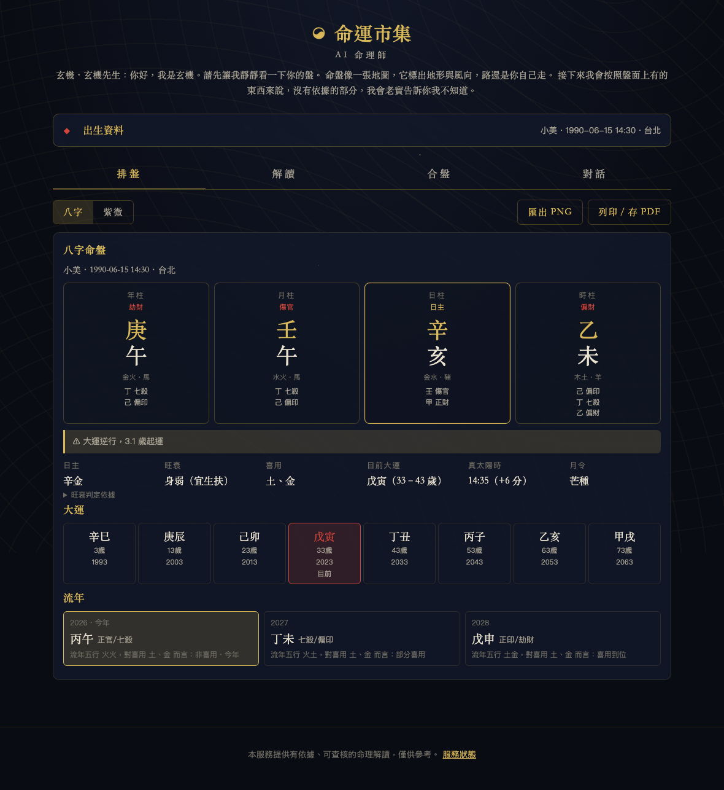
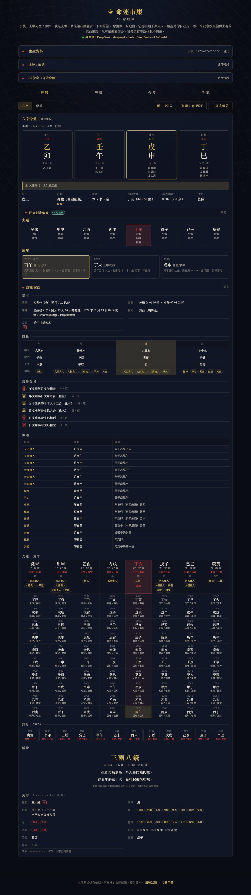

# 2-5 看懂八字盤上每一格

> 給零基礎學員。用本專案的畫面逐格說明：這是什麼、怎麼讀、常見誤解。
> 每一格都對應引擎裡一條有 id 的「事實」（`python -m fortune cast` 印出來的 `[bazi.xxx]`），解讀 AI 只准引用這些事實。

上圖是標準命例「小美，1990-06-15 14:30，女，台北」。由上往下：四柱、警示條、一列摘要（日主、旺衰、喜用、目前大運、真太陽時、月令）、大運列、流年格。

## 四柱：盤的主體

四個方塊從左到右是**年柱、月柱、日柱、時柱**，分別由出生的年、月、日、時決定。每一柱都是「一個天干＋一個地支」兩個字，例如年柱「庚午」。

每個方塊裡由上往下：

| 位置 | 是什麼 | 例（小美的年柱） |
|---|---|---|
| 最上面小字 | 柱名 | 年柱 |
| 紅色小字 | **十神**：這個天干相對於日主的關係 | 劫財 |
| 大字第一個 | **天干**（甲乙丙丁戊己庚辛壬癸） | 庚 |
| 大字第二個 | **地支**（子丑寅卯辰巳午未申酉戌亥） | 午 |
| 灰字 | 天干地支的五行與生肖 | 金火・馬 |
| 最下面幾行 | **藏干**：地支裡「藏」的一到三個天干，各自標十神 | 丁 七殺、己 偏印 |

**日柱**外框是金色的，因為日柱天干就是**日主**，整張盤都以它為中心；日柱上方不標十神，標「日主」。

怎麼讀：先看日主是什麼（辛金），再看另外七個字和它的關係（十神）。十神是八字最核心的「翻譯層」——它把十個天干翻成「比肩、劫財、食神、傷官、偏財、正財、七殺、正官、偏印、正印」十種關係，解讀時談的都是十神，不是天干本身。每個十神都有一張知識卡（`shishen.*`）。

常見誤解：
- 「年柱代表我這一年」——不是。年柱是出生那一年的干支，一輩子不變；「今年」是下面的流年。
- 「生肖看農曆年」——引擎以**立春**換年，不是農曆正月初一。立春前出生仍屬前一年（標準命例 `boundary_lichun_before`）。
- 「藏干只是裝飾」——藏干決定了一半的十神。小美的四個天干裡沒有正官，但時支未藏丁火七殺，解讀時「官殺」仍算出現。

## 警示條（流派差異）

四柱下面的黃色框是 `warnings`，例如「大運逆行，3.1 歲起運」。這裡會出現的都是**流派有分歧或資料不足**的事：晚子時換不換日、沒有經度所以沒換真太陽時、時辰不明只排三柱、性別未填不排大運。它不是錯誤，是引擎在告訴你「這一步我用了某一派的規則，你的流派可能不同」。解讀 AI 也會收到這些警示。

## 摘要列

| 格 | 是什麼 | 怎麼讀 |
|---|---|---|
| 日主 | 日柱天干＋五行，例「辛金」 | 全盤的「我」 |
| 旺衰 | 身強／身弱，例「身弱（宜生扶）」 | 日主在這個月令、這些干支之間是強是弱。**這是簡化規則**：看月令得不得令、天干生扶或耗洩、地支有沒有通根，加總分數。點開「旺衰判定依據」會列出每一項加減分與免責說明。各流派算法差異很大，這裡只示範「規則要寫出來、可以查」 |
| 喜用 | 例「土、金」 | 依旺衰推出的「對日主有幫助的五行」：身弱取生扶（印、比劫），身強取剋洩耗。流年、大運吉凶的判斷都拿這個來比 |
| 目前大運 | 例「戊寅（33–43 歲）」 | 現在走到哪一步大運 |
| 真太陽時 | 例「14:35（+6 分）」 | 手錶時間依經度與均時差修正後的時刻，用來定時辰。台北比東八區標準經線偏東，通常加幾分鐘；11 月初可以加到二十分鐘，有時會把時支整個換掉（命例 `true_solar_time_flip`） |
| 月令 | 例「芒種」 | 出生時所在的節氣，決定月柱。月柱以**節**（立春、驚蟄、清明……）換月，不是以農曆月 |

## 大運列

八個方塊，每個是十年：干支、起始虛歲、起始西元年。目前所在的那一步會紅框標「目前」。大運方向（順行或逆行）由性別與年干陰陽決定，起運歲數由出生到下一個（或上一個）節氣的天數換算（三天折一年）。

怎麼讀：大運像「十年一換的環境」。看大運干支的五行在不在喜用裡，就是總論那一段方向的判定依據（`sections.py` 的 overview 規則）。

常見誤解：「大運沒到就是沒有運」——出生到起運前的那幾年，傳統另以小運或月令論；本專案標「尚未起運」而且解讀總論改以日主與旺衰描述，不會硬套。

## 流年格

三格：今年、明年、後年。每格有干支、十神（天干／地支本氣）、以及「流年五行對喜用而言：喜用到位／部分喜用／非喜用」。這一行就是流年段方向的判定：到位＝吉、部分＝平、非喜用＝凶。今年那格會加框標「今年」。

對話裡問「2030 年如何」時，AI 會呼叫 `recast_year(2030)` 重算，不會自己編。

## 為什麼缺時辰仍能排三柱

年、月、日三柱只需要日期與節氣，和幾點出生無關。時柱才需要時辰。所以沒有時辰時，引擎照排三柱、十神照算，只是時柱標「資料不足」，而且警示條會說明「時柱與相關判斷（子女、晚年、身宮）標示為資料不足」。這比硬猜一個時辰誠實——紫微則不行，因為紫微的命宮位置直接由時辰決定（見 guide-ziwei.md）。

---

## 詳細盤面

四柱下方「詳細盤面」展開後是坊間排盤軟體的那一整頁。上圖是「aaa，2026-10-08 15:57，男，台北」（這張盤的故事見 validation-zydx.md）。由上往下逐區說明。

### 基本：農曆、節氣、起運、胎元、命宮

- **農曆**（`bazi.lunar`）：例「丙午年（馬）八月廿八 申時」。只供對照，八字本身不用農曆月（用節氣），但很多人只記得農曆生日。
- **節氣**（`bazi.terms`）：例「寒露 10-08 14:29 ～ 立冬 11-07 17:51」。出生時所在的那個節氣區間，**精確到分鐘**。月柱就是由它決定。常見誤解：以為節氣是一整天——其實是一個瞬間；同一天出生、差兩小時可能差一個月柱。而且這個瞬間全球同一刻，比對時用手錶時間，不用真太陽時。
- **起運**（`bazi.qiyun`）：例「出生後 9 年 10 個月 17 天 23 小時起運，2036-08-26 05:42 交運，之後每逢尾數 6 的年份換運」。從出生到相鄰節氣的時間，三天折一年、一天折四個月、一時辰折十天換算。常見誤解：起運歲數是整數——大多數軟體四捨五入成「10 歲起運」，這裡給精確值，兩邊對照時要知道差在四捨五入。
- **胎元**（`bazi.taiyuan`）：受胎月的干支（月干進一、月支進三），例「己丑（霹靂火）」，括號是納音。古法用來補看先天。
- **命宮**（`bazi.minggong`）：由月支與時支反推的一個干支，例「己亥（平地木）」。註明「生月以節為準，另一派以中氣為準」——又是流派差異。注意這個「命宮」和紫微的命宮是兩個不同的東西。

### 四柱加列：納音、空亡、長生、神煞

一張表，四欄對應年、月、日、時，日柱那欄加底色。

- **納音**（`bazi.nayin.*`）：每組干支對應一個「某某金／木／水／火／土」的名字，例年柱丙午「天河水」。純查表（六十甲子納音表）。用途：稱骨、胎元、命宮都會附納音；有些流派拿納音看性情。常見誤解：以為納音五行就是干支五行——丙午是火火，納音卻是「水」，兩套不同。
- **空亡**（`bazi.kongwang.*`）：每一柱所在的「旬」缺的兩個地支，例日柱乙卯空亡「子丑」。查表。傳統說落空亡的地支「力量打折」。常見誤解：空亡是壞事——它是「空」不是「凶」，有時反而解煞。
- **長生**（`bazi.changsheng.*`）：日主在各柱地支的十二長生階段，例日主乙在卯是「臨官」、在戌是「墓」。十二個階段各有一張知識卡（`changsheng.*`）。**它是能量盛衰的比喻**：長生、沐浴……病、死、墓、絕、胎、養，像一個循環。常見誤解：看到「病」「死」就緊張——那只是階段名稱，不是講身體，知識卡第一句就會提醒。
- **神煞**：這一列是各柱地支落到的神煞標籤，下面另有總表。

### 刑沖合會

列出盤內地支與天干之間的關係（`bazi.relations`），例「月支戌與日支卯六合（化火）」「年支午與日支卯相破」。合代表互相牽引，沖代表對立，刑、破、害是比較弱的摩擦。合盤（第 7-4）也用同一套規則比兩張盤。

常見誤解：「有沖就不好」——沖是動能，看落在哪一柱、沖到的是喜用還是忌神。解讀 AI 會拿它和十神一起講，不會單獨下斷語。

### 神煞總表

三欄：名稱、落點、依據。例「天乙貴人｜時支申｜日干乙見子申」。**依據那一欄就是查表的規則**，每一條都寫出來，所以你可以拿任何一本書對。十九個常用神煞各有一張知識卡（`shensha.*`）。

常見誤解：
- 「神煞越多越好／桃花就是爛桃花」——神煞是輔助標籤，古書通常說「以格局為主、神煞為輔」。
- 各家起法不同：有些神煞（例如吊客）各書起法不一致，引擎乾脆不排，對照別家軟體時會看到那幾個缺，是故意的。
- 由月支而來的神煞（紅鸞、天醫、部分貴人）會跟著月柱走：月柱排錯，它們整串跟著錯。

### 大運 × 流年

八欄，每欄一步大運：干支、年齡區間、天干地支十神、日主在該地支的長生階段、該地支落到的神煞；下面十格是這十年內每一年的流年（西元年、干支、十神）。目前那步會加框。

怎麼讀：先橫著看大運（十年的環境），再直著看流年（當年的事件）。問「某一年如何」時，看那一年的流年落在哪一步大運裡，兩者合看。

常見誤解：把大運和流年混在一起算分數——引擎的方向規則裡，總論看大運、流年段看流年，是分開的。

### 流月

當年十二格，每格一個月：節氣名、干支、十神。月份一樣以**節**為界（寅月從立春起），不是西曆月、也不是農曆月。常見誤解：「10 月就是戌月」——10 月 8 日 14:29 之前還是酉月。

### 稱骨

袁天罡稱骨歌：年、月、日、時各查一個重量，加總後對一首四句歌訣。例「四兩四錢（年 13・月 15・日 8・時 8）」。純查表，是民間趣味，引擎附註「各書版本有出入」。常見誤解：把它當正式論命——它是給學員理解「查表型」最直覺的例子，解讀 AI 不會引用它下結論。

---

## 怎麼用這份指南

1. 先拿自己的生辰排一次，把每一格對著這份指南找到對應的事實 id（`python -m fortune cast` 的方括號）。
2. 再拿 `docs/img/bazi-detail.png` 那張盤去對 validation-zydx.md，看一次「月柱錯了會帶動哪幾格跟著錯」。
3. 第 5 章寫知識卡時，記住每張卡的 keywords 要能對上事實的文字，否則 `select_cards()` 挑不到它。
