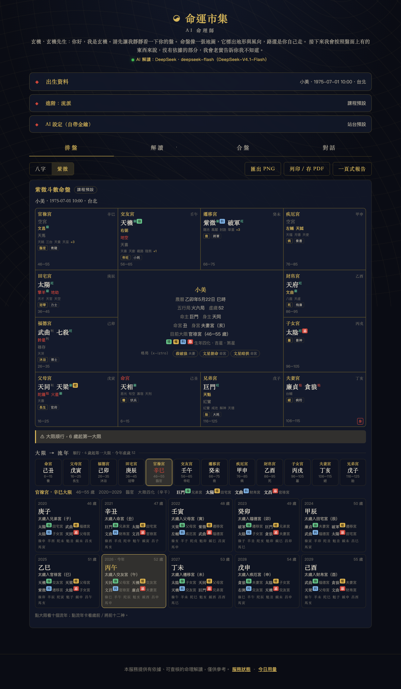
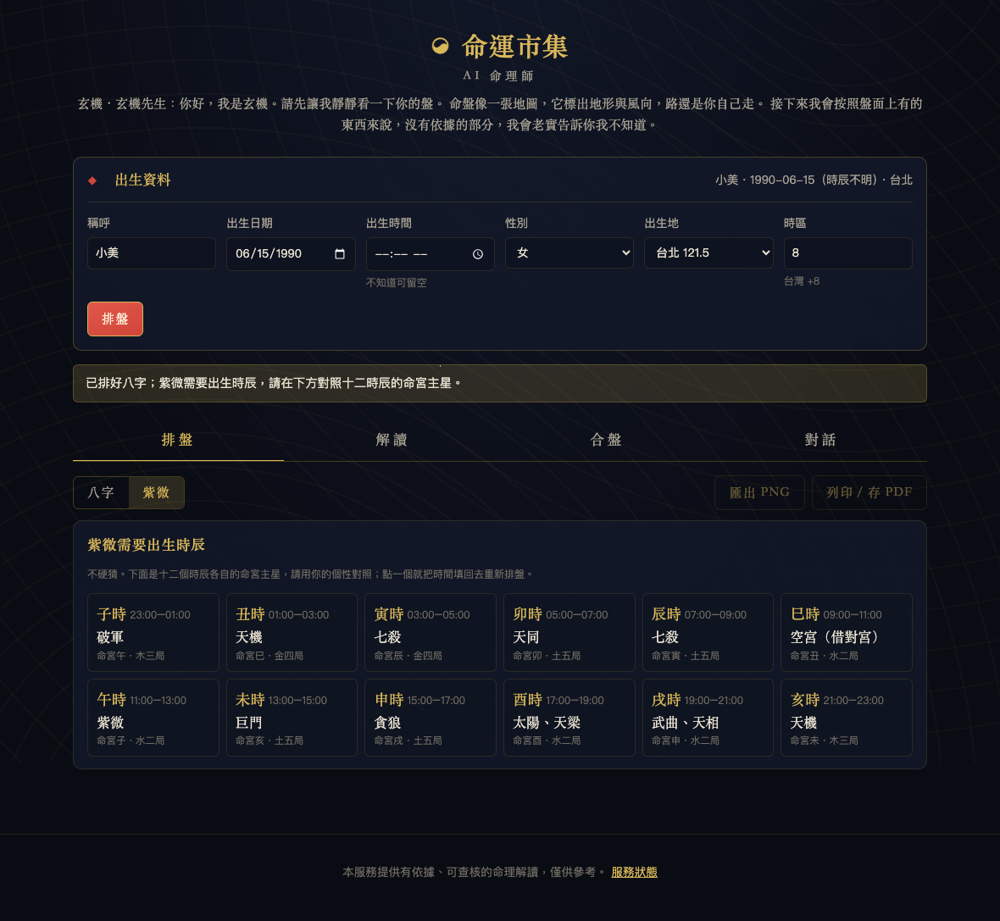
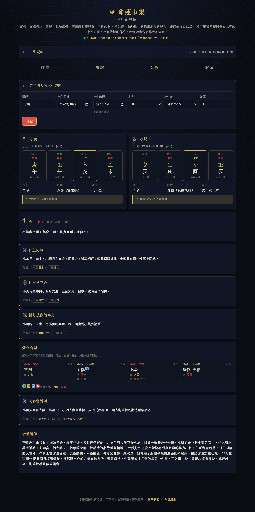

# 2-5 看懂紫微盤上每一格

> 給零基礎學員。用本專案的畫面逐格說明：這是什麼、怎麼讀、常見誤解。
> 每一格對應引擎的一條事實（`python -m fortune cast` 印出的 `[ziwei.xxx]`），解讀 AI 只准引用這些事實。



上圖是標準命例「小美，1990-06-15 14:30，女，台北」。

## 4×4 的十二宮：位置是固定的

紫微盤是一個 4×4 的方格，外圈十二格是十二宮，中央 2×2 合併成資訊區。**外圈的位置永遠固定**，由十二地支決定，不隨人改變：

```
 巳 │ 午 │ 未 │ 申
────┼───┴───┼────
 辰 │       │ 酉
────┤ 中央  ├────
 卯 │       │ 戌
────┼───┬───┼────
 寅 │ 丑 │ 子 │ 亥
```

也就是：上排由左到右是巳午未申，右欄往下酉戌，下排由左到右是寅丑子亥，左欄往上卯辰。程式裡就是一張表（`web/app.js` 的 `ZIWEI_POS`）。

會動的是**宮名**：命宮落在哪一格由出生月與時辰決定，其餘十一宮從命宮起逆時針排（兄弟、夫妻、子女、財帛、疾厄、遷移、交友、官祿、田宅、福德、父母）。小美的命宮在亥（右下角），所以兄弟宮在戌、夫妻宮在酉……順著逆時針方向一路排回父母宮在子。

怎麼讀：先找命宮（紅字），再順著逆時針找你關心的宮。常見誤解：以為每個人的命宮都在同一格——固定的是地支，不是宮名。

## 每一格裡有什麼

以小美的夫妻宮為例，一格由上往下：

| 位置 | 是什麼 | 例 |
|---|---|---|
| 左上 | **宮名**；命宮用紅字 | 夫妻宮 |
| 右上 | **宮干支**：這一格的天干地支。地支固定、天干由年干用「五虎遁」推 | 乙酉 |
| 大字 | **主星**（十四主星，一格零到三顆）；星名旁的小色標是**四化** | 太陰 ＋ 藍色「科」 |
| 金色小字 | **吉星**（左輔、右弼、文昌、文曲、天魁、天鉞） | — |
| 紅色小字 | **煞星**（擎羊、陀羅、火星、鈴星、地空、地劫） | 擎羊 |
| 灰色小字 | 其他常用輔星（祿存、天馬、紅鸞、天喜） | 紅鸞 |
| 左下 | **大限年齡**：這一宮主管的那十年（虛歲） | 25–34 |
| 右下 | **身宮標記**：有紅色「身」字的那一格就是身宮 | （小美的身宮在福德宮） |

四化的顏色：綠「祿」、黃「權」、藍「科」、紅「忌」。中央資訊區下方有圖例。

### 主星

十四主星是紫微盤的骨架：紫微、天機、太陽、武曲、天同、廉貞、天府、太陰、貪狼、巨門、天相、天梁、七殺、破軍。每顆一張知識卡（`star.*`）。它們的位置由五行局與農曆生日查「紫微定位表」決定紫微的位置，其餘十三顆依固定相對位置排出——所以主星錯一顆，通常是整組錯。

怎麼讀：主星決定一個宮的「基本性格」。命宮主星是你本人的底色，夫妻宮主星是你在感情裡的樣子，官祿宮是工作上的樣子。

### 吉星與煞星

六吉、六煞各自有安法（依年干、年支、時辰、月份）。它們不決定基調，但會加減力道。方向規則（`sections.py`）就是這樣算的：吉星 +1、煞星 −1、祿權科 +1、忌 −1，合計正為吉、負為凶、零為平。這條規則刻意簡單，目的是讓你看得懂、改得動。

常見誤解：看到擎羊、火星就以為那個宮一定不好。煞星配對的主星有時反而是動力（例如七殺、破軍遇煞），知識卡會寫常見組合。

### 四化

每年的天干會讓四顆星「化」成祿、權、科、忌，這叫**生年四化**。小美庚年生：太陽化祿、武曲化權、太陰化科、天同化忌。畫面上這四顆星旁邊會有色標；中央區也會列出。每個化各一張知識卡（`hua.*`）。流年也有流年四化（以流年天干推），列在 `ziwei.liunian.*` 的事實裡。

常見誤解：化忌＝壞——化忌常被解成「牽掛、放不下」，它指出的是課題所在，知識卡會這樣寫。

### 大限

每個宮管十年，從命宮開始，依性別與年干陰陽決定順行或逆行。第一個大限幾歲開始由五行局決定（水二局 2 歲、木三局 3 歲、金四局 4 歲、土五局 5 歲、火六局 6 歲）。小美土五局、逆行，所以命宮 5–14、兄弟宮 15–24……畫面上每格左下角的數字就是。目前所在的大限會在中央區標出（例「子女宮（35–44 歲）」）。

性別沒填時，順逆無法判定，引擎不排大限、警示條說明，解讀也不談。

## 中央資訊區

| 行 | 是什麼 |
|---|---|
| 名字 | 命主的名字 |
| 農曆 | 例「庚午年5月23日 未時」。紫微**全部用農曆**（年、月、日、時辰），和八字用節氣不同。閏月怎麼歸是流派問題（預設上半月歸本月、下半月歸次月，命例 `leap_month_2023`） |
| 五行局・虛歲 | 五行局（水二、木三、金四、土五、火六）由命宮干支的納音決定，影響紫微星位置與大限起始歲數。虛歲是今年的虛歲 |
| 命主・身主 | 兩顆「代表星」：命主依命宮地支查表、身主依生年地支查表。**它們不是命宮裡的星**——小美的命主是巨門，命宮主星剛好也是巨門，純屬巧合；2026 例的命主是巨門、命宮主星卻是廉貞七殺 |
| 命宮・身宮 | 命宮落在哪個地支；身宮落在哪一宮（例「福德宮（丑）」）。身宮是第二個重點宮，傳統說「命宮看先天、身宮看後天」 |
| 目前大限 | 今年走到哪一宮的大限 |
| 圖例 | 四化四色、吉星金色、煞星紅色 |

## 為什麼紫微一定要時辰

命宮的位置由「出生農曆月」與「出生時辰」一起決定：從寅宮順數到生月，再從那裡逆數到生時。時辰不同，命宮差一格，整張盤的十二宮名全部移位，五行局、紫微星位置、大限全部跟著變。八字缺時辰只是少一柱，紫微缺時辰是**整張盤不存在**。所以引擎對缺時辰的紫微回 `422 needs_birth_time`，不硬猜。

## 缺時辰：十二時辰候選卡怎麼用



畫面會列十二張小卡，每張是一個時辰（子時 23:00–01:00、丑時 01:00–03:00……）假設成立時的命宮地支與命宮主星，例「未時 → 命宮亥 巨門」「申時 → 命宮戌 貪狼」。

用法：
1. 請使用者讀每一張的命宮主星知識卡（命宮主星是本人的底色），挑最像自己的一到三個時辰。
2. 用家人說的「大概早上／傍晚」排除掉一半。
3. 點一張，程式把該時辰的中間時刻填回表單重排，就得到完整的盤。

這叫「定時辰」，傳統是命理師用來回推的手法；程式只是把十二種可能全部排出來給你比，**選擇仍然是人做的**。解讀 AI 在使用者選定之前不會對紫微說任何話。

常見誤解：以為程式「猜」了一個時辰。它沒有，它列出全部十二個並標明是候選。

## 空宮借對宮

一個宮沒有任何主星就叫**空宮**，畫面上會顯示「空宮」。傳統做法是「借對宮」：看正對面那一格（巳對亥、午對子……，也就是地支相沖的那一格）的主星來論。引擎會在事實裡寫明，例 2026 例的「福德宮（辛卯）：空宮（吉星 右弼；煞星 地空；天喜；對宮財帛宮主星 紫微、貪狼，借對宮看）」。

常見誤解：空宮＝這方面一片空白。不是，空宮只是主星不在這裡，借對宮之後照樣有內容；而且空宮裡仍可能有吉煞星與四化。

## 合盤在比什麼



合盤頁把兩張盤並排，列出一條條「項目」，每條標種類（合／沖／生／剋／同）與可以點開的依據。八字與紫微各比幾件事：

| 比什麼 | 怎麼比 | 種類 |
|---|---|---|
| 日主五行 | 兩人日主五行相生、相剋、相同 | 生／剋／同 |
| 天干五合 | 兩人日干是否成五合（甲己、乙庚、丙辛、丁壬、戊癸） | 合 |
| 地支合沖 | 年支、日支之間六合、相沖、相刑、半三合；日支是配偶宮所以加重 | 合／沖 |
| 喜用互補 | 對方的日主五行是不是你的喜用 | 生 |
| 命宮主星入夫妻宮 | 甲的命宮主星出現在乙的夫妻宮（或借對宮） | 合 |
| 四化互入 | 甲的化祿落在乙的命宮或夫妻宮（帶來助益）、化忌落入（容易成為牽掛） | 生／剋 |
| 夫妻宮對照 | 兩人夫妻宮煞星多寡的型態是否相近 | 同／沖 |

最後統計合／生／同幾件、沖／剋幾件，給一段總評。每一件都能追回兩張盤上的那一格，沒有一條是「感覺」。常見誤解：合盤算分數定緣分——它列的是相處會順或會磨的「面向」，分數只是計數。

---

## 怎麼用這份指南

1. 排自己的盤，先找命宮，順逆時針數一圈把十二宮名對一遍。
2. 把命宮、夫妻宮、官祿宮、財帛宮的主星知識卡各讀一張。
3. 不填時辰排一次，看候選卡；再填回去，看哪些格子動了（幾乎全部）。這是理解「紫微為什麼要時辰」最快的方法。
